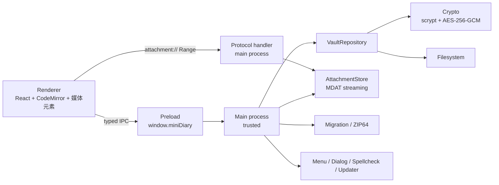

# Mini Diary 开发流水线 v2.0

> 技术栈：Electron + React + Vite + TypeScript + SCSS  
> 适用仓库：`/Users/wxm/Desktop/LYH/project/mini-diary`  
> 界面语言：**仅简体中文**（不引入 i18n 基础设施；文案集中管理）  
> 产品形态：纯本地、离线、加密的桌面日记应用（macOS / Windows / Linux）  
> 文档版本：2.1 · 2026-11-06  
> 替代文档：`docs/implementation-pipeline.md`（v1，保留作历史参考）  
> 执行方式：`P0 → P14` 严格串行；上一阶段 Gate 不绿，不进入下一阶段。

---

## 0. 变更摘要

### 0.1 相对 v1 的四条硬变更

| # | 变更 | 影响 |
|---|---|---|
| 1 | **取消 i18n，仅维护简体中文** | 删除 i18next / 语言偏好 / 语言切换 / 词条对齐测试；新增 `shared/copy.ts` 集中管理文案；菜单、日期、PDF、错误提示全部固定中文 |
| 2 | **附件必须支持图片、音频、视频，并加密存储** | 新增流式分块 AEAD 格式（`MDAT`）；新增 `attachment://` 解密代理协议，支持 HTTP Range，视频可拖动进度；附件不再整体读入内存 |
| 3 | **一键迁移必须做好** | 新增 `.minidiary` 整库迁移包（ZIP64 + 流式读写）；支持整库替换/合并、新密码、断点清理、失败回滚；新增独立阶段 P10 |
| 4 | **取消备份功能** | 不做自动备份、50 份历史、备份列表/恢复、备份 UI；迁移包是唯一“全量副本”。迁移/导入/改密保留临时回滚点，成功后立即清理；重置/删除前提示导出迁移包 |

### 0.2 参考方案取舍

对另一份 AI 文档（墨记 Inkwell）逐项评估后的结论：

| 参考方案 | 结论 | 原因 |
|---|---|---|
| 取消 i18n，`shared/copy.ts` 集中文案 | **采纳** | 与本次需求一致；比“只删语言包、文案散落”更可维护 |
| 图片/音频/视频全部加密 | **采纳** | 安全要求；媒体文件不能明文落盘 |
| 分块 AEAD 流式加密 + `attachment://` 解密代理 | **采纳** | 2GB 视频不能整体读入内存；视频 seek 必须依赖 Range |
| `yazl` + `yauzl` 实现 ZIP64 流式迁移包 | **采纳** | 避免全内存 ZIP；支持大附件和 >4GB 包 |
| 三栏布局（导航 / 条目列表 / 编辑器） | **采纳** | 日历 + 最近条目 + 搜索结果的浏览效率明显更好 |
| 一键迁移包（整库导出/导入、replace/merge） | **采纳** | 与本次“一键迁移要做好”直接对应 |
| 迁移/导入前临时回滚 + 失败回滚 | **采纳（不保留长期备份）** | 用户数据操作必须可恢复；成功后清理 |
| 迁移包内放 `prefs.json`（可移植偏好） | **采纳** | 换机后主题、周起始日等不需要重设；不迁移机器路径 |
| 安全红线：DEK 不跨 IPC、附件流式读写、禁止整文件 `readFile` | **采纳** | 本项目安全基线 |
| 媒体格式/性能预算（首帧、seek、包吞吐） | **采纳并调整** | 保留视频首帧/seek 指标；迁移吞吐按 SSD 实测，不写死为验收硬指标 |
| 自动备份 / 50 份历史 / 备份恢复 | **不采纳（用户确认取消）** | 单用户本地使用，不需要版本历史；完整副本只通过迁移包；避免 2GB 视频 × 50 份占满磁盘 |
| 全局 `backgroundThrottling: false` | **不采纳** | 会无谓增加耗电；媒体播放与迁移都在主进程/按需处理，不需要全局关闭节流 |
| 附件路径按日期分目录 | **调整** | 路径会泄露“哪天有附件”；改为 `attachments/<uuid>.mdat` |
| PDF 用 `marked` 但不 sanitize | **调整** | 保留 `marked` 生成 HTML，但必须 `sanitize-html`，并在隐藏窗口加载 |
| 配置化 `backupKeep`、`backupInterval`、`autosaveDebounce` | **不采纳** | 不做备份；自动保存仍固定 800ms，减少设置项和测试面 |
| `MergeMode` 支持 append/replace/skip | **部分采纳** | 外部导入固定“同日自动合并”；迁移包支持 replace/merge 两种整库模式 |
| 手写 guards 替代 Zod | **不采纳** | 继续用 Zod；IPC、导入、迁移都需要统一 schema 校验，收益大于体积成本 |
| 视频转码/抽帧缩略图 | **采纳为明确非目标** | 需要 ffmpeg 原生依赖，违背零原生模块与打包简化；使用 `<video>` 原生首帧与播放控件 |
| 自动锁定只做锁屏 | **补充** | 保留锁屏/挂起锁定；额外提供“空闲自动锁定”可选设置，默认关闭 |

### 0.3 工期与阶段

- 15 个阶段：`P0`–`P14`。
- 单人全职约 **45–50 人日**（含 10%–15% 缓冲），约 10–11 周。
- `P9` 结束：核心写作、日历、搜索、统计、外部导入导出完成。
- `P10` 结束：一键迁移包完成，达到“可以换电脑”的状态。
- `P14` 结束：三端可安装、可更新、可发布。

---

## 1. 执行协议

### 1.1 门禁

每个阶段结束必须跑：

```bash
pnpm typecheck
pnpm lint
pnpm test:unit
pnpm test:component
pnpm build
```

聚合：

```bash
pnpm verify
```

E2E：

```bash
pnpm test:e2e
```

| 门禁 | 标准 |
|---|---|
| G-TYPE | main / preload / renderer 三套 tsconfig 全部 0 error |
| G-LINT | ESLint、Stylelint 0 error |
| G-TEST | 单测/组件测试全绿；核心模块覆盖率 ≥ 80%，加密/附件格式/迁移模块 ≥ 90% |
| G-BUILD | `pnpm build` 成功；打包后应用可启动 |
| G-E2E | 本阶段相关 E2E 全绿；关键路径不能只靠手工 |
| G-MANUAL | 阶段手工验收清单全部勾选 |

### 1.2 数据安全红线（任何阶段不得违反）

- 明文正文、明文附件、DEK 永不落盘。
- DEK 永不跨 IPC；密码只在主进程使用一次。
- 附件读写必须流式，禁止 `readFileSync` / `readFile` 整个附件。
- 渲染进程不能拿到原始文件路径、文件句柄或 Node 能力。
- `attachment://` 只做解密代理，不做静态目录映射。
- 迁移包导入必须防 Zip Slip、Zip Bomb、符号链接和路径穿越。
- 禁止把解密后的媒体交给 Chromium 磁盘缓存：响应必须 `Cache-Control: no-store`。
- 密码、密钥、明文条目不得进入日志、崩溃报告、测试快照。
- 迁移、导入、改密前必须保留临时回滚点并支持回滚，成功后立即清理；重置/删除前必须提示导出迁移包，用户确认“不可恢复”后才执行。

### 1.3 基线处理

当前仓库是 Mini Diary 3.3.0 旧代码（React 16 + Redux + Webpack 4 + Electron 8），且工作区存在未提交改动。开工顺序：

1. 由仓库所有者提交或 stash 现有改动，禁止直接丢弃。
2. 打 tag：`legacy-v3.3.0`。
3. 创建分支：`rewrite/vite-electron`。
4. 在 `docs/adr/0001-rewrite.md` 记录：重写理由、appId、首发版本、附件上限、迁移包格式、签名证书状态。
5. 旧代码只作为导入导出格式、旧加密文件和交互参考，不再参与构建。

---

## 2. 产品范围与默认决策

### 2.1 产品目标

一款**本地优先、默认加密、离线可用**的桌面日记：

- 一天一篇，按本地日期索引。
- 标题 + Markdown 正文，轻量工具栏。
- 密码解锁，锁屏自动锁定。
- 日历、条目列表、标签、搜索、附件、统计。
- 图片可预览；音频可播放；视频可播放并拖动进度。
- 所有附件与正文一样加密落盘。
- 一键迁移：一个文件带走整库（含全部附件）。
- 仅简体中文界面。
- macOS / Windows / Linux 可安装、可自动更新。

### 2.2 默认决策（开工前确认）

| 编号 | 决策 | 默认值 | 说明 |
|---|---|---|---|
| A1 | 日记库数量 | 单用户、单日记库 | 不支持多库；未来再扩展 |
| A2 | 条目粒度 | 一天一篇 | 导入同一天内容合并 |
| A3 | 日期语义 | 本地日历日期 `YYYY-MM-DD` | 不把 UTC 日期当索引 |
| A4 | 密码找回 | 不提供 | 忘记密码无法恢复；迁移包也由密码加密，不能绕过密码；UI 必须明确 |
| A5 | 云同步 | 不做 | 纯本地文件；可放网盘目录 |
| A6 | 附件类型 | 图片、音频、视频、其他文件 | 图片/音频/视频必须可预览/播放；其他文件可保存 |
| A7 | 附件上限 | 图片 50MB；音频 500MB；视频 2GB；其他 2GB | 超过 300MB 二次确认；不做转码 |
| A8 | 界面语言 | 仅简体中文 | 不引入 i18n；文案集中在 `shared/copy.ts` |
| A9 | 主题 | 系统 / 浅色 / 深色 | 默认跟随系统 |
| A10 | 自动更新 | GitHub Releases | 仅签名/公证正式包启用 |
| A11 | 多窗口 | 单窗口 | 第二次启动聚焦已有窗口 |
| A12 | 应用身份 | 新 `appId` + 首发 `4.0.0` | 或 P0 ADR 决定沿用旧 appId；见风险 R11 |
| A13 | 备份功能 | 不做自动备份、历史版本、备份列表/恢复 | 单用户本地使用；迁移包是唯一全量副本；迁移/导入/改密仅保留临时回滚点 |
| A14 | 空闲自动锁定 | 默认关闭，可选 5/15/30/60 分钟 | 锁屏/挂起始终立即锁定 |
| A15 | 周起始日 | 默认周一；可设周日–周六 | 固定中文日期格式，不做 locale 自动检测 |
| A16 | 迁移包 | `.minidiary`，ZIP64，整库含附件 | 支持 replace / merge；支持新密码 |

### 2.3 不做（v2 非目标）

- 云同步、账号、共享、多设备实时合并。
- 自动备份、历史版本、备份列表/备份恢复（用户确认取消）。
- 多语言/i18n、语言切换、翻译流程。
- 富文本 WYSIWYG（正文以 Markdown 源码为准）。
- 视频转码、压缩、抽帧缩略图、音频波形（避免 ffmpeg 原生依赖）。
- 移动端、浏览器版。
- 多日记库、多用户。
- 密码提示、密保、密码找回。
- 外部格式导入图片/音视频（迁移包才能完整搬运附件）。
- macOS App Store 分发（只做 Developer ID + 公证 + DMG/ZIP）。
- 插件、自定义 CSS、自定义主题编辑器。

### 2.4 核心体验

- 三栏：左侧导航/搜索/日历，中间条目列表，右侧编辑器。
- 打开即写；`Cmd/Ctrl+N` 回到今天。
- 图片在正文内预览；音频/视频用原生控件播放，视频可拖动进度。
- 一键迁移：设置里点“导出迁移包”，新电脑点“导入迁移包”，选择文件即可。
- 日历有内容的日期高亮；搜索结果显示在中间列表，点击跳到对应日期。

---

## 3. 需求追踪矩阵

> 收尾时逐行勾选。阶段列是主要落点，不代表其他阶段不能补测试。  
> 注：原需求中的“多语言界面”已按最新决策取消，N6 改为“仅简体中文，文案集中管理”。

### 3.1 日记与附件

| ID | 需求 | 实现落点 | 验收标准 | 阶段 |
|---|---|---|---|---|
| D1 | 创建日记并设置密码 | Onboarding + `vault:create` | 首次启动可设密码并生成加密库；过短/不一致被拒绝 | P4 |
| D2 | 密码解锁、锁定日记 | 解锁页 + `vault:unlock/lock` + 菜单 | 错误密码不解密；锁定后内容立即从 UI 消失 | P4 |
| D3 | 锁屏自动锁定 | `powerMonitor` 的 `lock-screen`/`suspend` | 模拟锁屏后 1.5 秒内锁定；可选空闲锁定 | P4 |
| D4 | 按日期写日记 | 选中日期 ↔ `entry.date` | 任意日期可打开；条目只写入该日期 | P5/P6 |
| D5 | 标题 + Markdown 正文 | 标题输入 + CodeMirror | 保存后重开完全一致 | P6 |
| D6 | 加粗、斜体、有序列表、无序列表 | 工具栏 + 快捷键 + 编辑命令 | 选中/空选区都能正确插入；可撤销 | P6 |
| D7 | 字数统计 | `countWords` + 状态栏 + 列表 | 中英混合 fixture 固定；输入实时更新 | P3/P6 |
| D8 | 自动保存、失焦保存 | `useAutosave` + 主进程写队列 | 800ms 防抖；失焦/切日期/锁定前 flush | P6 |
| D9 | 隐藏标题 | 偏好 + 编辑器条件渲染 | 开启后标题输入隐藏，已存标题不丢 | P6/P11 |
| D10 | 拼写检查开关 | 偏好 + Electron session | 切换即时生效；重启保持 | P11/P12 |
| D11 | 允许/禁止写未来日期 | 偏好 + 日历/日期校验 | 禁止时未来日期不可选；导入未来条目不破坏 | P5/P11 |
| D12 | 标签 | 标签输入 + Entry.tags | 添加/删除/去重/持久化；搜索和标签筛选可命中 | P6/P8 |
| D13 | 图片/附件（图片预览） | 加密附件仓库 + `attachment://` | 插入/预览/删除；重启后可见；磁盘无明文 | P7 |
| D14 | 音频、视频附件 | 加密附件仓库 + 原生播放器 | 可播放；重启后可用；锁定后不可读 | P7 |
| D15 | 音视频进度拖动 | `attachment://` Range 解密代理 | 200MB 视频可 seek；首帧/seek 达性能预算 | P7 |

### 3.2 日历与列表

| ID | 需求 | 实现落点 | 验收标准 | 阶段 |
|---|---|---|---|---|
| C1 | 月历展示 | 自研 `Calendar` | 6×7 网格；跨月日期灰显 | P5 |
| C2 | 有日记的日期高亮 | `entriesByDate` | 有内容日期显示圆点；空条目不显示 | P5 |
| C3 | 点击日期切换日记 | 日历 → flush → 切换 | 切换前保存当前条目 | P5 |
| C4 | 上个月/下个月切换 | 月份导航 | 跨年边界正确；日号规则固定 | P5 |
| C5 | 回到今天 | Today 按钮 | 跳回今天并选中 | P5 |
| C6 | 跳转到指定日期 | 跳转弹窗 | 非法日期被拒绝 | P5 |
| C7 | 自定义每周第一天 | 偏好 + 日历计算 | 周日–周六任选；默认周一 | P5/P11 |
| C8 | 中文日期显示（原“本地化日期显示”） | date-fns `zh-CN` | 中文月份/星期/日期；无语言切换 | P5 |
| C9 | 条目列表 | 三栏中间列表 | 显示日期、摘要、字数、附件图标；可切换月份/标签/搜索 | P5/P8 |

### 3.3 搜索

| ID | 需求 | 实现落点 | 验收标准 | 阶段 |
|---|---|---|---|---|
| S1 | 搜索标题和正文 | `searchEntries` 纯函数 | 标题、正文、标签均可命中；大小写不敏感 | P8 |
| S2 | 实时搜索 | `useDeferredValue` + 内存索引 | 输入即出结果；1000 篇/5 万字 < 100ms | P8 |
| S3 | 点击结果跳转到对应日期 | 结果列表 → 选中日期 | 点击后选中正确日期并高亮 | P8 |
| S4 | 无结果提示 | 空状态 | 明确显示“没有找到相关日记”，不清空搜索框 | P8 |

### 3.4 安全与文件

| ID | 需求 | 实现落点 | 验收标准 | 阶段 |
|---|---|---|---|---|
| F1 | 密码加密日记文件 | scrypt + AES-256-GCM | 磁盘无明文；错误密码/篡改密文均失败 | P3 |
| F2 | 修改密码 | `vault:changePassword` | 旧密码校验；新密码可解锁；已导出迁移包仍用原包密码 | P4 |
| F3 | 自动备份，保留最近 50 份（需求变更：取消） | 不实现备份 | 不生成备份文件、不提供备份 UI；迁移包是唯一全量副本 | P11 |
| F4 | 修改日记文件目录 | `vault:moveDirectory` | 迁移整目录；失败可回滚 | P4 |
| F5 | 移动日记文件 | 同上（含 attachments） | 目标目录完整；源目录清理；无数据丢失 | P4 |
| F6 | 重置/删除日记 | 两道确认 + 密码校验 | 重置清空内容；删除移除库并回到引导页 | P4 |
| F7 | 加密文件格式版本迁移 | `formatVersion` + `schemaVersion` + migrator | 旧 fixture 可升级；升级前保留临时回滚点；未来版本拒绝写入 | P3 |
| F8 | 旧版 Mini Diary 加密文件迁移 | 旧算法一次性导入 | 正确密码可迁移；迁移后仅保留新格式 | P4 |
| F9 | 一键迁移（整库导出/导入） | `.minidiary` + `migration:*` | 完整包含正文/附件/标签/偏好；replace/merge；失败回滚 | P10 |
| F10 | 迁移包完整性校验 | manifest + SHA-256 + schema | 缺文件、篡改、版本过新均拒绝；不产生半新半旧状态 | P10 |
| F11 | 附件加密与流式读写 | `MDAT` + `attachment://` | 无明文附件；无整文件读内存；锁屏后中断流 | P7 |

### 3.5 导入（外部格式）

| ID | 需求 | 实现落点 | 验收标准 | 阶段 |
|---|---|---|---|---|
| I1 | Day One JSON | `import/dayOneJson.ts` | 日期/标题/正文/标签映射正确；图片附件明确警告 | P9 |
| I2 | jrnl JSON | `import/jrnlJson.ts` | 标题/正文/日期/标签映射正确 | P9 |
| I3 | Mini Diary JSON | `import/miniDiaryJson.ts` | 兼容旧导出结构；`dateUpdated` 保留 | P9 |
| I4 | Day One TXT | `import/dayOneTxt.ts` | 多条目分块、日期解析、标题/正文拆分正确 | P9 |
| I5 | 同一天内容自动合并 | `mergeEntries` | 不覆盖已有内容；标题/正文/标签合并规则固定 | P9 |

> 外部格式导入只导入文本；附件完整搬运使用“一键迁移包”（F9），两者不要混淆。

### 3.6 导出（外部格式）

| ID | 需求 | 实现落点 | 验收标准 | 阶段 |
|---|---|---|---|---|
| E1 | Mini Diary JSON | `export/miniDiaryJson.ts` | 可被旧版/新版重新导入；附件以元数据列出 | P9 |
| E2 | Markdown | `export/markdown.ts` | 日期/标题/正文/标签完整；可选复制附件 | P9 |
| E3 | PDF | `marked` + `sanitize-html` + 隐藏窗口 | 中文、图片、分页正常；音视频显示附件卡片 | P9 |
| E4 | Day One TXT | `export/dayOneTxt.ts` | 可被 Day One 导入；附件以文件名列出 | P9 |

### 3.7 统计

| ID | 需求 | 实现落点 | 验收标准 | 阶段 |
|---|---|---|---|---|
| T1 | 总条目数 | `calcStats` | 空库 0；只统计有内容条目 | P8 |
| T2 | 每周平均条目数 | `calcStats` | 按周起始偏好计算；边界周正确 | P8 |
| T3 | 最长连续记录 | `calcStats` | 断档、单条、跨月/跨年正确 | P8 |
| T4 | 当前连续记录 | `calcStats` | 今天/昨天锚定规则固定 | P8 |
| T5 | 总字数 | `calcStats` | 与 `countWords` 一致；标题计入 | P8 |
| T6 | 每篇平均字数 | `calcStats` | 无条目为 0；展示 1 位小数 | P8 |

### 3.8 偏好设置

| ID | 需求 | 实现落点 | 验收标准 | 阶段 |
|---|---|---|---|---|
| P1 | 主题：自动/浅色/深色（自动=跟随系统） | `nativeTheme` + CSS Token | 即时生效；重启保持 | P11 |
| P2 | 每周第一天 | `firstDayOfWeek` | 0–6 生效；日历/统计同步 | P11 |
| P3 | 是否隐藏标题 | `hideTitle` | 即时影响编辑器/列表/搜索标题 | P11 |
| P4 | 是否允许未来日记 | `allowFutureEntries` | 即时影响日历可选范围 | P11 |
| P5 | 拼写检查 | `spellcheck` | 即时开关；英文词典可用 | P11 |
| P6 | 日记文件目录 | 偏好显示 + 迁移入口 | 展示当前路径；修改走移动流程 | P11 |
| P7 | 修改密码 | 密码弹窗 | 旧密码校验；新密码生效 | P11 |
| P8 | 重置日记 | 危险操作区 | 密码 + 确认短语 | P11 |
| P9 | 空闲自动锁定 | `autoLockMinutes` | 默认关闭；可选 5/15/30/60 分钟 | P11 |
| P10 | 迁移包入口 | 导出/导入迁移包 | 一键导出全量数据；新电脑可导入 | P11 |
| P11 | 清理未引用附件 | 附件 GC | 二次确认；提示删除后不可恢复，建议先导出迁移包 | P11 |

### 3.9 桌面端与样式

| ID | 需求 | 实现落点 | 验收标准 | 阶段 |
|---|---|---|---|---|
| N1 | 原生应用菜单 | `Menu.buildFromTemplate` | 中文菜单完整；平台差异正确 | P12 |
| N2 | 快捷键 | 菜单 accelerator + 编辑器 keymap | 常用操作可用；不与系统冲突 | P12 |
| N3 | 导入/导出文件选择 | 主进程 `dialog` | 过滤器正确；取消不报错 | P9/P12 |
| N4 | 系统主题跟随 | `nativeTheme` | 系统切换深浅色时 UI 跟随 | P11/P12 |
| N5 | 自动更新 | `electron-updater` | 正式包可检查/下载/安装；开发态禁用 | P13 |
| N6 | 多语言界面（需求变更：仅简体中文） | `shared/copy.ts` | 无语言切换；菜单/对话框/PDF/错误全中文 | P2/P12 |
| N7 | macOS/Windows/Linux 打包 | electron-builder | 三端安装包可启动；签名/公证通过 | P13 |
| N8 | `.minidiary` 文件关联 | electron-builder `fileAssociations` + `open-file`/argv | 双击迁移包打开导入向导 | P10/P12 |
| U1 | 自研 React 组件 + SCSS 主题；少量 headless | `components/ui` + SCSS Modules + Radix | 无 UI 框架；主题 Token；键盘可达 | P2/P6 |
| U2 | 三栏桌面布局 | 侧栏 / 条目列表 / 编辑器 | 窄窗口可折叠；不依赖路由 | P2/P5 |

---

## 4. 目标架构

### 4.1 进程边界



| 层 | 职责 | 禁止 |
|---|---|---|
| Main | 文件、加密、密钥、附件流、协议、迁移、导入导出、菜单、更新 | 不渲染 UI；不向渲染进程暴露 DEK/原始路径 |
| Preload | 白名单、类型化的 IPC 桥；拖拽文件路径转换 | 不暴露 `ipcRenderer`/`fs`/`require` |
| Renderer | UI、编辑、搜索、统计、媒体播放 | 不读写文件；不持有密码/密钥；不整体加载附件 |
| Shared | 类型、Zod、纯函数、中文文案 | 不依赖 Electron/Node 文件系统 |

### 4.2 目录结构

```text
mini-diary/
├─ electron.vite.config.ts
├─ electron-builder.yml
├─ package.json
├─ pnpm-lock.yaml
├─ src/
│  ├─ main/
│  │  ├─ index.ts
│  │  ├─ window.ts
│  │  ├─ ipc/
│  │  ├─ preferences.ts
│  │  ├─ vault/
│  │  │  ├─ crypto.ts
│  │  │  ├─ format.ts
│  │  │  ├─ repository.ts
│  │  │  ├─ paths.ts
│  │  │  └─ migrations/
│  │  ├─ attachments/
│  │  │  ├─ format.ts          # MDAT v1 头、分块 AEAD
│  │  │  ├─ store.ts           # 流式写入/读取/删除/校验
│  │  │  └─ protocol.ts        # attachment:// + Range
│  │  ├─ migration/
│  │  │  ├─ package.ts         # .minidiary manifest
│  │  │  ├─ export.ts
│  │  │  ├─ import.ts
│  │  │  └─ staging.ts
│  │  ├─ core/
│  │  │  └─ zip.ts             # yazl/yauzl 流式 ZIP64
│  │  ├─ import/
│  │  ├─ export/
│  │  ├─ menu/
│  │  ├─ updater.ts
│  │  ├─ spellcheck.ts
│  │  └─ logger.ts
│  ├─ preload/
│  │  ├─ index.ts
│  │  └─ api.ts
│  ├─ renderer/
│  │  ├─ index.html
│  │  ├─ print.html            # PDF 隐藏窗口
│  │  └─ src/
│  │     ├─ main.tsx
│  │     ├─ app/
│  │     ├─ features/
│  │     │  ├─ onboarding/
│  │     │  ├─ unlock/
│  │     │  ├─ calendar/
│  │     │  ├─ entry-list/
│  │     │  ├─ editor/
│  │     │  ├─ attachments/
│  │     │  ├─ search/
│  │     │  ├─ stats/
│  │     │  ├─ preferences/
│  │     │  └─ migration/
│  │     ├─ components/ui/
│  │     ├─ stores/
│  │     ├─ styles/
│  │     └─ media/
│  └─ shared/
│     ├─ types.ts
│     ├─ schemas.ts
│     ├─ ipc.ts
│     ├─ copy.ts               # 所有中文文案
│     ├─ date.ts
│     ├─ words.ts
│     ├─ search.ts
│     └─ stats.ts
├─ tests/
│  ├─ unit/
│  ├─ component/
│  ├─ e2e/
│  ├─ fixtures/
│  │  ├─ media/                 # 小 mp4/webm/png/mp3
│  │  ├─ vault/
│  │  └─ migration/
│  └─ setup/
└─ docs/
   ├─ implementation-pipeline-v2.md
   └─ adr/
```

### 4.3 技术选型

| 领域 | 选择 | 理由 |
|---|---|---|
| 壳 | Electron 最新稳定版（≥ 30） | `protocol.handle`、Range、nativeTheme、updater 成熟 |
| 构建 | electron-vite | main/preload/renderer 一套配置；HMR |
| UI | React + TypeScript strict | 团队熟悉；类型安全 |
| 状态 | Zustand（4 store） | 轻量、无 Provider；迁移/播放状态独立 |
| 编辑器 | CodeMirror 6 + lang-markdown | Markdown 源码性能好；原生 spellcheck；可插入媒体卡片 |
| 样式 | SCSS Modules + CSS 变量 | 自研组件 + 主题 Token |
| Headless | Radix（Dialog/AlertDialog/Switch/Select/Tooltip/DropdownMenu/Popover） | 只提供无障碍行为 |
| 日期 | date-fns + `locale/zh-CN` | 固定中文；周起始可配 |
| 搜索 | 自研纯函数 | 中文子串可靠；1000 篇量级足够 |
| 加密 | Node `crypto`：scrypt + AES-256-GCM | 零原生依赖 |
| 附件流 | 自研 `MDAT` 分块 AEAD + `protocol.handle` | 大视频流式解密、Range seek |
| ZIP64 | `yazl` 写 + `yauzl` 读 | 流式、ZIP64、纯 JS |
| 类型检测 | `file-type` | 纯 JS 识别图片/音频/视频容器 |
| PDF HTML | `marked` + `sanitize-html` | 主进程生成 HTML；必须 sanitize |
| PDF 字体 | `@fontsource/noto-sans-sc` | 三端中文不乱码 |
| 日志 | `electron-log` | 主进程文件日志；脱敏 |
| 更新 | `electron-updater` | GitHub Releases |
| 打包 | electron-builder | 三端 |
| 测试 | Vitest + RTL + Playwright `_electron` | 单测 + 真实 Electron |
| i18n | **无** | 仅简体中文；`shared/copy.ts` |

**零原生依赖**：不引入 ffmpeg、sharp、better-sqlite3、argon2 等需要 `node-gyp` 的包。视频播放依赖 Chromium 自带解码器；不支持转码。

### 4.4 依赖

运行时（renderer）：

```text
react react-dom
zustand
zod
date-fns
@codemirror/lang-markdown @codemirror/state @codemirror/view @codemirror/commands
@codemirror/language @codemirror/search @lezer/highlight
react-markdown remark-gfm rehype-sanitize
@radix-ui/react-dialog @radix-ui/react-alert-dialog @radix-ui/react-switch
@radix-ui/react-tooltip @radix-ui/react-dropdown-menu @radix-ui/react-select
@radix-ui/react-popover @radix-ui/react-scroll-area
lucide-react
```

运行时（main）：

```text
electron-log electron-updater
yazl yauzl
file-type
marked sanitize-html
@fontsource/noto-sans-sc
```

开发：

```text
electron electron-vite vite typescript
eslint prettier stylelint sass-embedded
vitest @vitest/coverage-v8 jsdom
@testing-library/react @testing-library/user-event @testing-library/jest-dom
@playwright/test
electron-builder
@types/yazl @types/yauzl @types/sanitize-html
```

**移除**：`i18next`、`react-i18next`、`adm-zip`。  
**新增**：`yazl`、`yauzl`、`file-type`、`marked`、`sanitize-html`、`@fontsource/noto-sans-sc`。

版本策略：P0 首次 `pnpm install` 解析出的版本即基线，提交 `pnpm-lock.yaml`；Electron 大版本升级只允许在 P0 或 P13 做，并在三端重测视频播放。

### 4.5 状态

| Store | 内容 | 持久化 |
|---|---|---|
| `useVaultStore` | `status`、`unlockError`、`busyJob`（迁移/导入/导出）、`progress`、`cancel` | 否 |
| `useEntriesStore` | `entries[]`、`activeDate`、`dirty`、`saveState`、`searchQuery`、`listFilter` | 否 |
| `useUiStore` | 三栏折叠、弹窗、Toast、lightbox、主题解析、媒体播放状态 | 主题走 prefs |
| `usePrefsStore` | 偏好副本 | 主进程 `preferences.json` |

原则：

- 主进程是磁盘数据的唯一事实源；渲染进程 entries 是解锁后的明文镜像。
- 附件二进制永不整体进入渲染进程内存；媒体元素通过 `attachment://` 按需流式读取。
- 不在 store 里存密码、DEK、解密后的附件内容。
- `busyJob` 只允许一个迁移/导入/导出任务；任务期间禁止锁定以外的数据操作。

### 4.6 IPC 契约

| Channel | 入参 | 返回 | 说明 |
|---|---|---|---|
| `app:bootstrap` | — | `{ prefs, vaultStatus, theme, version }` | 启动；不返回条目 |
| `vault:create` | `{ password }` | `VaultSnapshot` | 生成 DEK |
| `vault:unlock` | `{ password }` | `VaultSnapshot` | 失败统一错误码 |
| `vault:lock` | — | `void` | 清空 DEK，广播 `vault:locked` |
| `vault:changePassword` | `{ currentPassword, newPassword }` | `void` | 重包 DEK；已导出迁移包不受影响 |
| `vault:moveDirectory` | `{ targetDir }` | `{ diaryDir }` | 完整迁移 |
| `vault:reset` | `{ password }` | `VaultSnapshot` | 清空内容；先提示导出迁移包 |
| `vault:delete` | `{ password }` | `void` | 删除库并回 onboarding；不可恢复 |
| `entry:save` | `{ entry }` | `{ revision, savedAt }` | 校验 date/title/tags/附件引用 |
| `entry:delete` | `{ date }` | `{ revision }` | 清空/删除 |
| `attachment:addFromPath` | `{ sourcePath }` | `Attachment` | 对话框/拖拽文件；主进程流式加密 |
| `attachment:addBytes` | `{ name, mime, bytes }` | `Attachment` | 粘贴图片；≤50MB |
| `attachment:cancel` | `{ jobId }` | `void` | 取消上传并清理 `.part` |
| `attachment:delete` | `{ id }` | `void` | 只删引用；blob 延迟清理 |
| `attachment:saveAs` | `{ id }` | `{ path? }` | 流式解密到用户选择路径；提示明文 |
| `attachment:cleanup` | `{ dryRun }` | `{ count, bytes }` | 清理未引用 blob |
| `migration:export` | `{ packagePassword }` | `{ path }` | 打开保存框；流式 ZIP64 |
| `migration:preview` | `{ filePath }` | `{ token, summary }` | 校验包；不写库 |
| `migration:import` | `{ token, packagePassword, mode, newPassword }` | `{ revision }` | replace / merge |
| `migration:cancel` | `{ jobId }` | `void` | 取消并清理 staging |
| `import:preview` | `{ format, filePath }` | `{ token, summary }` | 外部格式 |
| `import:commit` | `{ token }` | `{ revision }` | 原子导入 |
| `export:run` | `{ format, includeAttachments? }` | `{ path? }` | 外部格式导出 |
| `prefs:read` | — | `Preferences` | 不含敏感信息 |
| `prefs:update` | `Partial<Preferences>` | `Preferences` | 广播 |
| `dialog:pickDirectory` | `{ purpose }` | `{ path? }` | 目录选择 |
| `app:checkForUpdates` | — | `void` | 正式包 |
| `shell:openExternal` | `{ url }` | `void` | 只允许 `https:` |

事件（main → renderer）：

| Event | 用途 |
|---|---|
| `app:flush-request` | 保存并准备锁定/退出 |
| `vault:locked` | 清空 entries/搜索/媒体 URL/播放器 |
| `prefs:changed` | 主题/周起始/拼写等即时更新 |
| `theme:changed` | 系统主题变化 |
| `menu:command` | 菜单/快捷键触发 |
| `job:progress` | 附件上传/迁移/导入/导出进度 |
| `job:done` / `job:error` | 任务完成/失败 |
| `update:status` | 更新状态 |

`attachment://` **不是 IPC**，由主进程 protocol handler 直接返回流。

### 4.7 附件协议

- 注册（app ready 前）：

```ts
protocol.registerSchemesAsPrivileged([{
  scheme: "attachment",
  privileges: { standard: true, secure: true, supportFetchAPI: true, stream: true, corsEnabled: true },
}]);
```

- URL：`attachment://<uuid>`，只允许 UUID；无路径、无查询参数。
- 请求处理：
  - 未解锁 → `423 Locked`；
  - 附件不在当前 vault → `404`；
  - 解析 `Range`（单区间；多区间返回 200 全量）；
  - `HEAD` 返回头无 body；
  - 合法 Range → `206`，带 `Content-Range`、`Content-Length`、`Accept-Ranges: bytes`；
  - 非法 Range → `416`，带 `Content-Range: bytes */<size>`；
  - 无 Range → `200`，流式返回。
- 响应头：
  - `Content-Type` 来自加密元数据；
  - `Cache-Control: no-store`；
  - `Content-Disposition: inline`。
- 锁定：中止所有正在进行的流；播放器立即停止。
- 读取：按 chunk 解密，不整文件加载；支持 backpressure。

CSP：

```text
default-src 'self';
script-src 'self';
style-src 'self' 'unsafe-inline';
img-src 'self' data: blob: attachment:;
media-src 'self' attachment: blob:;
font-src 'self' data:;
connect-src 'self'
```

### 4.8 安全基线

- `contextIsolation: true`、`nodeIntegration: false`、`sandbox: true`、`webSecurity: true`、`webviewTag: false`。
- 单实例锁；第二实例只聚焦窗口。
- 禁止任意导航、`window.open`、应用内外链；外链只允许 `https:`。
- 所有 IPC 校验 sender + Zod。
- 所有路径参数 `realpath` 后必须位于允许目录内。
- 附件 ID 只允许 UUID；文件名仅展示，不拼路径。
- 生产 CSP 不允许 `unsafe-eval`；`style-src 'unsafe-inline'` 仅因 CodeMirror/Radix 需要。
- 不启用崩溃上报；如启用必须默认关闭、隐私说明、脱敏。
- `pnpm audit` 无 high/critical；例外写 ADR。

---

## 5. 数据与加密

### 5.1 领域模型

```ts
type LocalDate = string; // 'YYYY-MM-DD'

type AttachmentKind = 'image' | 'audio' | 'video' | 'file';

interface Attachment {
  id: string;            // UUID v4
  name: string;          // 原始文件名，仅展示
  mime: string;
  kind: AttachmentKind;
  size: number;          // 明文字节数
  sha256: string;        // 明文 SHA-256，十六进制
  chunkSize: number;     // 默认 1 MiB
  totalChunks: number;
  createdAt: string;
}

interface DiaryEntry {
  date: LocalDate;       // 唯一键
  title: string;
  body: string;          // Markdown 源码
  tags: string[];        // 小写、去重、不含 '#'
  attachments: Attachment[];
  wordCount: number;     // 由 countWords(title + body) 计算并缓存
  createdAt: string;
  updatedAt: string;
}

interface VaultData {
  schemaVersion: 1;
  vaultId: string;
  createdAt: string;
  updatedAt: string;
  entries: DiaryEntry[];
}

interface VaultSnapshot {
  schemaVersion: number;
  revision: number;      // 运行时，不写入
  entries: DiaryEntry[];
}

interface Preferences {
  version: 1;
  theme: 'system' | 'light' | 'dark';
  firstDayOfWeek: 0 | 1 | 2 | 3 | 4 | 5 | 6; // 0=周日，默认 1
  hideTitle: boolean;
  allowFutureEntries: boolean;
  spellcheck: boolean;
  autoLockMinutes: 0 | 5 | 15 | 30 | 60;      // 0=关闭
  diaryDir: string;
  lastOpenedDate: string | null;
  lastImportDir: string | null;
  lastExportDir: string | null;
}
```

约束：

- `date` 唯一；同一天一篇。
- 标题 ≤ 500 字符；正文不设硬上限，> 2MB 提示性能风险。
- 标签 ≤ 32 字符、≤ 100 个；小写去重。
- 附件上限见 A7；0 字节文件拒绝。
- `sha256` 用于迁移/导出的完整性校验；播放时不每次校验全文件。
- `wordCount` 在主进程保存时重算，避免渲染进程与磁盘不一致。

### 5.2 Vault 信封

`diary.vault` 是 JSON 信封：

```json
{
  "magic": "MINIDIARY",
  "formatVersion": 1,
  "vaultId": "uuid",
  "createdAt": "ISO",
  "kdf": { "name": "scrypt", "N": 131072, "r": 8, "p": 1, "salt": "base64" },
  "keyWrap": { "alg": "AES-256-GCM", "iv": "base64", "ciphertext": "base64", "tag": "base64" },
  "payload": { "alg": "AES-256-GCM", "iv": "base64", "ciphertext": "base64", "tag": "base64" }
}
```

- `KEK = scrypt(password, salt, N=2^17, r=8, p=1, 32B)`。
- `DEK` 随机 32B，用 KEK 包裹；DEK 永不直接落盘。
- `payloadKey = HKDF(DEK, vaultId, "payload-v1")`。
- `attachmentKey = HKDF(DEK, vaultId, "attachment-v1")`。
- `keyWrap` AAD 绑定 KDF 参数；`payload` AAD 固定为 `MINIDIARY|payload|1|vaultId`。
- 每次写 payload 新随机 IV；错误密码/损坏统一提示“密码错误或文件已损坏”。
- 改密码只重包 DEK；已经导出到外部的迁移包不受影响，继续使用导出时的包密码。
- 迁移包的 payload 密文可保持不变，只需用迁移包密码重包 DEK。

### 5.3 附件格式 `MDAT v1`

附件不是普通文件，而是分块加密容器：

```text
偏移  字段            长度
0     magic "MDAT"     4
4     version          1   (=1)
5     flags            1
6     headerSize       2   (=64)
8     fileId          16   UUID 原始字节
24    chunkSize        4   默认 1 MiB
28    totalChunks      4
32    plaintextSize    8
40    noncePrefix      8   随机
48    headerTag       16   HMAC-SHA256(fileKey, header[0..48])
```

- `fileKey = HKDF-SHA256(attachmentKey, salt=fileId, info="mdat-v1")`。
- `headerTag` 用 `fileKey` 对前 48 字节做 HMAC，截断 16 字节。
- 第 `i` 块：
  - nonce = `noncePrefix(8) || uint32be(i)`（12 字节）；
  - AAD = `header[0..48] || uint32be(i) || uint32be(chunkPlainLength)`；
  - 密文 = AES-256-GCM(plaintext chunk) + 16B tag；
  - 除最后一块外，块大小 = `chunkSize`。
- `totalChunks = ceil(plaintextSize / chunkSize)`；0 字节拒绝。
- 读取任意 Range：按偏移算起始 chunk，只读相关块；解密后 slice。
- 篡改/截断/重排 chunk 都会 GCM 失败；`plaintextSize`/`totalChunks` 与 vault 元数据双重校验。
- `sha256` 用于迁移包完整校验；可在导入时顺带流式计算。

**为什么不用整文件 AES-GCM**：2GB 视频整体读入内存会 OOM；视频 seek 需要随机访问；分块 AEAD 是唯一合理方案。

### 5.4 磁盘布局

```text
<DiaryDir>/
├─ diary.vault
├─ attachments/
│  ├─ <uuid>.mdat
│  └─ ...
├─ migration/                      # 临时 staging / .part / rollback，成功后清理
└─ .lock                           # 可选，单实例辅助
```

- 默认目录 `<Documents>/Mini Diary`；首次可改。
- 附件路径只含 UUID，不按日期分目录（避免泄露“哪天有附件”）。
- 权限：目录 `0700`，文件 `0600`（Windows 尽力而为）。
- 偏好：`userData/preferences.json`，不含密码/密钥。
- 迁移/PDF 不写明文临时文件；临时文件只放密文或最终包。

### 5.5 写入与操作回滚

写入：

1. 更新内存快照 → 序列化 `VaultData`。
2. 加密 payload → 写 `diary.vault.tmp` → fsync → rename。
3. 串行写队列；写失败保留内存脏数据，UI 提示重试。

**不做备份功能：**

- 不生成 `backups/`，不保留 50 份历史，不提供备份列表/恢复 UI。
- 迁移包是唯一全量副本；用户需要保留旧数据时，主动导出迁移包。
- 删除/重置前提示先导出迁移包，并明确“确认后不可恢复”。

**临时回滚点（不是备份功能）：**

- 改密、格式迁移、导入、迁移等高风险操作，可在 `migration/rollback-<jobId>/` 保留当前 vault/attachments 的临时副本。
- 操作验证成功后立即删除；失败时恢复。
- 临时回滚点不进入 UI、不轮转、不作为用户数据长期保存；应用启动时清理超过 24 小时的残留。
- 这不是“历史版本”，不改变“无备份功能”的产品决策。

### 5.6 附件生命周期

- 添加：主进程流式读取源文件 → 写 `<uuid>.mdat.part` → fsync → rename → 更新 entry → 保存 vault。
- 图片粘贴：≤50MB 走字节 IPC；超过则要求保存为文件后拖入。
- 拖拽/对话框：preload 用 `webUtils.getPathForFile(file)` 取得路径（只返回字符串），主进程再次校验并流式加密；渲染进程不直接拿 `fs`。
- 删除：只删 entry 引用；blob 先保留，避免误删后立刻不可恢复。
- 清理：手动 GC，显示可释放空间；不自动删除；清理前提示先导出迁移包。
- 锁定：中止所有 `attachment://` 流，播放器停止。
- 迁移：见第 8 章。

### 5.7 数据迁移

两层版本：

| 层 | 字段 | 作用 |
|---|---|---|
| 容器 | `formatVersion` | 信封结构/KDF |
| 数据 | `schemaVersion` | Entry/Vault 字段 |

- 未来版本 > 当前支持：拒绝写入，提示升级。
- 旧版本：解密后迁移；迁移前保留临时回滚点；迁移后以新格式重写。
- 迁移函数纯函数、幂等、单测。
- 旧版 `mini-diary.txt`（Mini Diary 3.3.0）迁移为独立实验性入口：
  - 密码经 PBKDF2-HMAC-SHA512（固定 salt、500000 次、64 字节）得到 128 字符十六进制字符串；
  - salt 按 UTF-8 字符串使用，不 base64 解码；哈希按字符串使用，不 hex 解码；
  - 旧 Node 的 `createCipher("aes-192-cbc", hashedPassword)` 已移除，需手动实现 `EVP_BytesToKey(MD5, no salt, 1 iteration)`，再用 `createDecipheriv("aes-192-cbc", key, iv)`；
  - 旧文件保留为 `.legacy-original`，新库验证成功后才提示删除；
  - 只读旧格式，不沿用其算法。
- 旧版算法细节与 fixture 见 v1 文档 §5.7.1，实现时以固定测试密码验证。

### 5.8 安全清单（Gate 必查）

- [ ] 正文/附件/DEK 无明文落盘。
- [ ] 附件读写流式；无 `readFile` 整个附件。
- [ ] `attachment://` 只接受 UUID；未解锁返回 423；锁屏中止流。
- [ ] Range 解析正确；206/416/HEAD 测试通过。
- [ ] 媒体响应 `Cache-Control: no-store`。
- [ ] 迁移包防 Zip Slip/Zip Bomb/符号链接；路径白名单。
- [ ] IPC sender + Zod 校验。
- [ ] 单实例；禁止任意导航/外链。
- [ ] CSP 无 `unsafe-eval`。
- [ ] 日志无敏感信息；崩溃上报默认关闭。
- [ ] 依赖审计无 high/critical。

---

## 6. 界面与交互

### 6.1 三栏布局

```text
┌──────────────┬────────────────────┬─────────────────────────────────┐
│ 侧栏          │ 条目列表            │ 编辑器                          │
│ 搜索 ⌘F      │ 2026-11-06 周五     │ 标题 input（可隐藏）            │
│ 日历          │ 今天 · 342 字 · 📎  │ 工具栏                          │
│ 标签          │ 2026-11-05 周四     │ CodeMirror Markdown             │
│ 统计          │ 雨 · 1180 字 · 🎬   │ 图片预览 / 音频 / 视频卡片       │
│ 设置 / 锁定   │ 2026-11-03 周一     │ 状态栏：字数 · 已保存 · 标签 · 📎 │
└──────────────┴────────────────────┴─────────────────────────────────┘
```

- 侧栏：搜索框、月历、标签列表、统计入口、设置/锁定。
- 中间列表：当前月份/标签/搜索结果的条目；显示日期、星期、摘要、字数、附件类型图标。
- 右侧编辑器：标题、Markdown 正文、附件条、状态栏。
- 窄窗口（< 1080px）：条目列表可折叠；< 920px 时只保留侧栏 + 编辑器，列表变抽屉。
- 不使用 react-router；视图状态由 `useUiStore` 管理。

### 6.2 日历与列表

- 6×7 月历；周一默认；可选周日–周六。
- 有内容日期高亮；未来日期在关闭偏好时禁用。
- 点击日期：flush 当前 → 选中 → 列表滚到该月 → 编辑器加载。
- 上/下月、Today、跳转日期弹窗。
- 键盘：方向键、PageUp/PageDown、Home/End、Enter；aria-label 中文日期。
- 列表过滤：月份 / 标签 / 搜索结果；点击条目切换日期。
- 列表虚拟化：1000 条以上用窗口化渲染；不为每行加载附件。

### 6.3 编辑器与媒体

- CodeMirror 6；Markdown 源码 + 语法高亮；预览切换。
- 标题独立 input；`hideTitle` 时隐藏但保留数据。
- 工具栏：加粗、斜体、无序列表、有序列表；选中/空选区；快捷键 `Mod+B`/`Mod+I`。
- 字数：状态栏正文计数；统计页标题 + 正文。
- 拼写检查：content DOM `spellcheck` + Compartment；主进程同步 session。
- 未来日期只读守卫。
- 空条目：无标题/正文/标签/附件不创建；清空已有条目时删除并 Toast 撤销 5 秒。
- 插入附件：
  - 图片：``；
  - 音频/视频：`[名称](attachment://<id>)`；
  - 其他：`[名称](attachment://<id>)`。
- 预览 renderer：
  - 图片：``，点击 lightbox；
  - 音频：`<audio controls preload="metadata" src="attachment://id">`；
  - 视频：`<video controls preload="metadata" src="attachment://id">`，支持 seek；
  - 其他：附件卡片，显示名称/大小/另存为。
- 编辑器内附件条：显示缩略图/类型/大小/删除；拖拽文件到编辑器直接添加。
- 不支持转码/缩略图；视频首帧由 `<video>` 自身提供，音频无波形。

### 6.4 搜索与统计

- 搜索标题、正文、标签；中文子串；AND；标题优先；结果显示在中间列表。
- `useDeferredValue`；1000 篇/5 万字 < 100ms。
- 点击结果选中日期，列表高亮，编辑器加载。
- 无结果空状态。
- 统计六项：总条目、每周平均、最长连续、当前连续、总字数、每篇平均；口径与 v1 一致。
- 周起始遵循偏好；当前连续以今天/昨天为锚；未来条目不参与连续统计。

### 6.5 偏好

- 外观：主题（系统/浅色/深色）、周起始日。
- 编辑：隐藏标题、允许未来日记、拼写检查、自动锁定时间。
- 文件：日记目录、导出/导入迁移包、清理未引用附件。
- 安全：修改密码、重置日记、删除日记。
- 迁移：导出迁移包、导入迁移包。
- **没有语言设置**。
- 所有文案来自 `shared/copy.ts`；日期固定 `zh-CN`；数字格式 `Intl.NumberFormat('zh-CN')`。

### 6.6 中文与文案

- 不引入 i18next；不检测系统语言；不做语言切换。
- `shared/copy.ts` 按模块组织，例如：

```ts
export const copy = {
  appName: 'Mini Diary',
  menu: { file: '文件', lock: '锁定日记', ... },
  editor: { placeholder: '写点什么…', bold: '加粗', ... },
  attachment: { add: '添加附件', image: '图片', audio: '音频', video: '视频', ... },
  migration: { export: '导出迁移包', import: '导入迁移包', ... },
  errors: { wrongPassword: '密码错误或文件已损坏', ... },
} as const;
```

- 菜单、对话框、PDF、错误提示、空状态全部引用 copy。
- date-fns 固定 `zhCN`；PDF 内嵌 Noto Sans SC；不依赖系统语言。
- 外部格式解析仍可识别英文月份（Day One TXT）；Day One TXT 导出遵循目标格式的英文日期，这不属于界面语言/i18n。

### 6.7 SCSS 主题

- `styles/tokens/_color.scss` 等；CSS 变量 `--md-*`。
- `<html data-theme="light|dark">`；系统主题由 `nativeTheme` 决定。
- 组件 `*.module.scss`；BEM 内部约定。
- 字体：系统 UI 字体；PDF 用 Noto Sans SC。
- 动效 150–200ms；`prefers-reduced-motion` 关闭。
- 不引入 Tailwind/Ant/MUI/Chakra。

### 6.8 无障碍

- 所有交互可键盘操作；焦点可见。
- Dialog 焦点陷阱/Esc；Switch/Select 语义正确。
- 日历 roving tabindex。
- 媒体控件保留原生键盘行为。
- 对比度满足 WCAG AA；Toast 使用 `aria-live`。
- 迁移/上传进度使用 `role="progressbar"` + 可读文本。

---

## 7. 外部导入与导出

### 7.1 导入映射

| 格式 | 日期 | 标题 | 正文 | 标签 | 附件 |
|---|---|---|---|---|---|
| Day One JSON | `creationDate` 日期部分 | 首行 `# ` 或首个空行前段落 | 剩余部分 | `tags[]` | 忽略，warning |
| jrnl JSON | `date` + `time` | `title` | `body` | 条目 `tags[]` | 无 |
| Mini Diary JSON | `entries` key | `title` | `text` | 可选 | 无 |
| Day One TXT | `\tDate:\t...` | 首个非空行 | 其余 | 无 | 无 |

- 外部导入只导入文本；附件完整搬运使用迁移包。
- 同一天自动合并：标题 `旧 | 新`，正文 `旧\n\n---\n\n新`，标签并集；不覆盖。
- 预览 token 提交；主进程解析，渲染进程不能伪造数据。
- 导入使用 staging + 临时回滚点；失败整批回滚，成功后清理。
- 明文导入文件需提示。

### 7.2 导出

| 格式 | 附件策略 |
|---|---|
| Mini Diary JSON | 附件元数据（id/name/mime/size/sha256），不含二进制 |
| Markdown | 可选复制附件到 `<basename>-attachments/`；默认包含；正文中的 `attachment://<id>` 重写为相对路径；>300MB 警告 |
| PDF | 图片内嵌；音频/视频以附件卡片列出名称/大小，不嵌入 |
| Day One TXT | 附件以文件名列出，不含二进制 |

- 导出前 flush；明文导出明确警告。
- PDF：
  - 主进程用 `marked` 生成 HTML，`sanitize-html` 清理；`allowedSchemes` 必须包含 `attachment`，并只允许安全的标签/属性；
  - 隐藏 `BrowserWindow` 加载 `print.html`，通过 IPC 接收 HTML；打印窗口使用**最小 preload**（只暴露 `print:html`，不暴露 vault/附件 API）；
  - 图片用 `attachment://`，等待 `img.decode()`；音频/视频显示为附件卡片，不嵌入媒体；
  - `printToPDF({ printBackground: true, pageSize: 'A4' })`；
  - 不写明文临时文件；打印窗口使用独立临时 session、禁用 cache，完成后销毁 session/window；若使用独立 session，必须在该 session 上注册同一个 `attachment://` handler，否则图片无法加载。
- Markdown 附件复制必须流式解密，不能整文件读内存；正文中的 `attachment://<id>` 必须改写成 `<basename>-attachments/<安全文件名>`，否则导出后链接不可用。
- 外部导出不是全量迁移；迁移包才是。

### 7.3 附件在外部格式中的限制

- Day One JSON 的照片/音频/视频字段不导入；在预览中逐条 warning。
- Mini Diary JSON 无附件二进制；导出时只保留元数据。
- 迁移包（第 8 章）是唯一保证附件完整的进出方式。
- 这是有意的边界：避免把外部格式导入做成半成品。

---

## 8. 一键迁移（重点）

### 8.1 目标

用户换电脑时：

1. 旧电脑：设置 → 迁移 → 导出迁移包 → 得到一个 `.minidiary` 文件。
2. 新电脑：安装应用 → 导入迁移包 → 选择文件 → 输入包密码 → 设置新密码 → 完成。
3. 正文、标题、标签、附件（图片/音频/视频）、偏好全部保留。

不要求用户理解目录结构、附件目录、zip、加密格式。

### 8.2 `.minidiary` 包格式

ZIP64 归档（`yazl` 写 / `yauzl` 读）：

```text
package.minidiary
├─ manifest.json
├─ vault.inkv
├─ prefs.json
├─ attachments/
│  ├─ <uuid>.mdat
│  └─ ...
└─ checksums.sha256
```

**“所有内容”的范围**：全部条目（标题、正文、标签、附件引用、字数、创建/更新时间）、`attachments/` 下全部附件密文（含孤儿）、可移植偏好。不包含日志、机器路径、临时文件、历史版本（本来就没有备份）。

- `manifest.json`（明文，只有元数据，无正文/文件名）：
  - `packageFormat: 1`
  - `appVersion`
  - `createdAt`
  - `formatVersion`, `schemaVersion`
  - `vaultId`
  - `entryCount`, `attachmentCount`, `totalAttachmentBytes`
  - `checksums`（或由 `checksums.sha256` 承载）
- `vault.inkv`：与 `diary.vault` 相同的加密信封；`keyWrap` 用**迁移包密码**包裹 DEK；payload 密文不变。
- `attachments/<uuid>.mdat`：原附件密文，按原样复制；使用 `store` 模式（不压缩）。
- `prefs.json`：可移植偏好（主题、周起始日、隐藏标题、未来日期、拼写、自动锁定），不含 `diaryDir`、上次目录等机器路径；导入时默认应用，机器相关字段忽略。
- `checksums.sha256`：每个成员的 SHA-256，导入时逐项校验。
- 包本身是 ZIP，不含明文；成员已是密文。manifest 仅暴露数量/大小，不暴露正文或附件名。

### 8.3 导出流程

1. Flush 当前条目；创建任务 `jobId`。
2. 选择保存位置（主进程 dialog）；文件名默认 `Mini Diary 迁移包 YYYY-MM-DD.minidiary`。
3. 输入迁移包密码（默认当前密码；可改；改密码只重包 DEK，不重加密附件）。
4. 检查磁盘空间（包大小 + 10% 余量）。
5. 写 `.part`：
   - 写 `manifest.json`；
   - 写 `vault.inkv`（重包 DEK header）；
   - 写 `prefs.json`；
   - 遍历 `attachments/` 下**所有** `.mdat`（包括暂未被 entry 引用的孤儿附件），逐个流式写入 ZIP（`store`），同时计算 SHA-256；确保“所有内容”都进包；
   - 写 `checksums.sha256`；
   - 关闭 ZIP，fsync，rename 为 `.minidiary`。
6. 进度事件；可取消；取消/失败删除 `.part`。
7. 成功后提示路径与大小；建议用户把包存到另一块磁盘/云盘。

约束：

- 不把附件解密后再压缩；直接复制密文，速度快且不泄露。
- 迁移包是唯一全量副本；不包含历史版本/备份，也不打包 `migration/` 临时目录。
- 附件按“目录全量”打包：包括未被 entry 引用的孤儿 `.mdat`；若用户想缩小包，先执行“清理未引用附件”再导出。
- 如果 entry 引用的附件文件缺失，导出必须失败并列出缺失 ID，禁止静默跳过。
- 迁移包密码可以与登录密码不同；忘记包密码无法恢复。
- 导出期间锁定/退出：中止任务并清理 `.part`。

### 8.4 导入流程

1. 选择 `.minidiary`（或双击文件关联）；首次启动的 onboarding 也必须提供“导入迁移包”入口，不能强迫用户先建空库。
2. 校验：
   - ZIP64/中央目录完整；
   - 只允许 `manifest.json`、`vault.inkv`、`prefs.json`、`attachments/<uuid>.mdat`、`checksums.sha256`；
   - 拒绝 `..`、绝对路径、符号链接、重复条目；
   - 限制条目数、总解压大小、压缩比（防 Zip Bomb）。
3. 读取 manifest，检查 `packageFormat`/`formatVersion`/`schemaVersion` 是否支持；未来版本拒绝。
4. 输入迁移包密码；解包 DEK；解密 vault；Zod 校验；若 `schemaVersion` 较旧，标记需要在 staging 中迁移；显示摘要（条目数、日期范围、附件数/总大小）。
5. 选择模式：
   - **replace**：用包内整库替换当前库；
   - **merge**：按日期合并，保留当前库，追加包内条目。
6. 输入新密码（可等于包密码）；检查磁盘空间。`prefs.json` 仅在 replace/新建时默认应用；merge 默认保留当前偏好，避免覆盖用户设置。
7. 写 staging 目录（同盘，保证 rename 原子性）：
   - replace（已有库）：保留目标 vault 的 DEK，解密包内附件并用目标 DEK 重新加密；用新密码重包目标 DEK；写新 vault；
   - replace（没有库）：采用包内 DEK，附件密文原样复制（含孤儿附件）；用新密码重包 DEK；
   - merge：解密包内附件 → **所有包内附件（含孤儿）生成新 ID** → 用目标 DEK 重新加密；合并 entries 并重写引用；孤儿附件保留为未引用文件；
   - 以上路径都校验 checksums，再创建 staging 的 `diary.vault`；若需要 schema 迁移，在 staging 内完成并再次校验。
8. 校验：用新密码重新解锁 staging → 抽样/全量校验附件 → 对比条目数。
9. 切换：
   - 将当前库目录保留为临时回滚点 `migration/rollback-<jobId>/`（成功后立即删除，不是备份功能）；
   - 原子 rename staging 到正式目录，并用新密码重新解锁验证；
   - 切换/验证失败则恢复旧目录；验证成功后删除临时回滚点。
10. 清理 staging/`.part`/rollback；重载 UI；提示结果。

### 8.5 replace / merge 语义

| 模式 | 行为 | 附件 | 适用 |
|---|---|---|---|
| `replace` | 包内整库替换当前库 | 已有库：保留目标 DEK，附件重新加密；无库：采用包内 DEK，附件原样复制 | 换新电脑、整库恢复 |
| `merge` | 保留当前库，按日期追加 | 包内附件重新加密到目标 DEK；生成新 ID | 合并两台机器的日记 |

`merge` 的同日规则与外部导入一致：标题 `旧 | 新`、正文 `旧\n\n---\n\n新`、标签并集、时间戳取较早/较晚、绝不覆盖。附件全部保留并去重（按 `sha256` 可选去重；默认保留，避免误删）。**merge 生成新附件 ID 时，必须同步替换正文中的 `attachment://<旧ID>` 引用**；替换完成后校验所有引用都能解析到 entry.attachments。

### 8.6 原子性与回滚

- 导出：`.part` → 校验 → rename；失败删除。
- 导入：staging 目录 → 校验 → 旧库临时回滚点 → 原子切换；失败回滚。
- `replace` 不立即删除旧 `attachments/`：先重命名为 `attachments.pre-migration-<jobId>`，验证新库成功后再提示清理；失败则恢复。磁盘检查必须把“旧附件 + 新附件”都算进去。
- 应用启动时清理超过 24 小时的 `migration/*.part` 与 staging。
- 迁移期间：
  - 禁止手动锁定/切库？允许手动锁定，但锁定会中止迁移并清理 staging；UI 明确提示。
  - 锁屏/挂起：立即中止迁移，保留原库；这是安全优先。
  - 退出：拦截并提示“迁移进行中”，确认后中止。
- 磁盘满/权限错误：保留原库，错误可读，给出剩余空间提示。

### 8.7 ZIP64 与流式

- 使用 `yazl`/`yauzl`，不把整个 ZIP 读入内存。
- `.mdat` 用 `store` 模式；`manifest`/`prefs` 可 deflate。
- 单文件 > 4GB 或包 > 4GB 时自动 ZIP64；`yauzl` 读取时支持 ZIP64。
- 写/读都用 `pipeline` + `Transform` 计算 SHA-256。
- 迁移 2GB 视频时内存峰值目标 < 200MB。
- 进度按字节计算，不按条目数（大文件也要平滑）。

### 8.8 文件关联

- 注册 `.minidiary` 扩展名（electron-builder `fileAssociations`）。
- macOS：`open-file` 事件。
- Windows/Linux：第二实例 `argv` 中识别路径。
- 双击包 → 应用启动 → 导入向导。
- 如果当前已解锁，直接进入导入；如果锁定，先解锁再继续。
- 关联失败不应阻塞应用启动；记录日志。

### 8.9 迁移测试 Gate

- [ ] 100 条文本 + 图片 + 音频 + 视频 + 孤儿附件 roundtrip，字节级一致。
- [ ] 2GB 视频包导出/导入，内存峰值 < 200MB，视频可播放/seek。
- [ ] 5GB 包路径（ZIP64）手动验证。
- [ ] 错误密码、篡改 manifest、缺附件、重复条目、路径穿越均拒绝。
- [ ] 中途取消/退出/断电模拟：原库不损坏，`.part`/staging 可清理。
- [ ] replace / merge 两种模式；merge 附件重新加密并可播放。
- [ ] 新密码生效；旧密码失败。
- [ ] 迁移后搜索、日历、统计、附件播放正常；临时回滚点已清理。
- [ ] 迁移包不包含明文字节；`strings`/扫描无正文/附件内容。

---

## 9. 阶段流水线

### 9.0 总览

| 阶段 | 交付 | 依赖 | 人日 |
|---|---|---|---|
| P0 | 基线、ADR、tag | — | 0.5 |
| P1 | 工程脚手架、质量门禁 | P0 | 1 |
| P2 | SCSS 设计系统、三栏外壳、中文文案、基础组件 | P1 | 2.5 |
| P3 | 领域模型、vault、加密、MDAT、临时回滚点、迁移 runner | P2 | 3.5 |
| P4 | 创建/解锁/锁定/改密/移动/重置/删除 + IPC | P3 | 3 |
| P5 | 日历 + 条目列表 + 日期导航 | P4 | 2.5 |
| P6 | 编辑器、自动保存、标签、媒体占位 | P5 | 4 |
| P7 | 图片/音频/视频附件、MDAT、`attachment://` Range | P6 | 5 |
| P8 | 搜索 + 统计 | P6/P7 | 2 |
| P9 | 外部导入/导出（JSON/MD/PDF/TXT） | P7 | 4 |
| P10 | **一键迁移包（ZIP64、replace/merge、回滚）** | P7/P9 | 6 |
| P11 | 偏好、数据管理、危险操作 UI | P4/P6/P7 | 1.5 |
| P12 | 原生菜单、快捷键、文件关联、主题、拼写 | P2/P10/P11 | 2 |
| P13 | 三端打包、签名、公证、自动更新、CI | P9/P10/P11 | 3 |
| P14 | 安全/性能/无障碍/迁移演练/发布 | 全部 | 4 |

合计约 44.5 人日；含缓冲约 **45–50 人日**。  
关键路径：`P0 → P1 → P2 → P3 → P4 → P6 → P7 → P10 → P13 → P14`。  
P5/P8/P9/P11/P12 可在接口稳定后并行。

### P0 — 基线（0.5 人日）

- [ ] 处理工作区未提交改动（提交/stash，禁止丢弃）。
- [ ] `git tag -a legacy-v3.3.0`。
- [ ] `git switch -c rewrite/vite-electron`。
- [ ] ADR：重写理由、appId、首发版本、附件上限、迁移包格式、无备份决策、签名证书。
- [ ] 提交本文件。

**Gate**：工作区干净；旧 tag 可读；旧源码未删除。

### P1 — 脚手架与门禁（1 人日）

- [ ] 临时目录生成 electron-vite React TS 模板，检查后移植：

  ```bash
  tmp="$(mktemp -d)"
  pnpm create @quick-start/electron@latest "$tmp/scaffold" --template react-ts
  # 若 CLI 不支持非交互参数，按提示选择 React + TypeScript
  ```

- [ ] 删除旧构建源码/配置（旧 `src`、`webpack.*.ts`、`bundle` 等，旧代码从 tag 取）。
- [ ] pnpm + Node 22/24 LTS + `packageManager`；允许 Electron 构建脚本。
- [ ] `tsconfig` strict、路径别名、三套 tsconfig。
- [ ] ESLint/Prettier/Stylelint、Vitest、RTL、Playwright。
- [ ] scripts：dev/build/typecheck/lint/test/verify/package:dir。
- [ ] 安全基线：contextIsolation/sandbox/CSP/单实例。
- [ ] 基础 electron-builder 配置。

**Gate**：`pnpm dev` 空白窗口；`pnpm verify` 全绿；`window.require` undefined；`package:dir` 可启动。

### P2 — 设计系统、三栏外壳、中文文案（2.5 人日）

- [ ] SCSS tokens、浅/深主题、reset、focus、scrollbar。
- [ ] UI：Button/IconButton/Input/Field/Dialog/AlertDialog/Switch/Select/Tooltip/Toast/Spinner/EmptyState/Progress。
- [ ] Radix 包装；样式全部自写。
- [ ] 三栏外壳：侧栏、条目列表、编辑器占位；窄窗折叠。
- [ ] `shared/copy.ts`；菜单/空状态/错误先用中文。
- [ ] 主题解析；首屏主题注入。
- [ ] 组件测试 + 浅/深截图。

**Gate**：键盘可操作基础组件；无硬编码颜色；三栏布局稳定；`copy.ts` 覆盖外壳文案。

### P3 — 领域、加密、MDAT、临时回滚点（3.5 人日）

- [ ] `shared/types.ts`、`schemas.ts`、`copy.ts`、`date.ts`、`words.ts`。
- [ ] `vault/crypto.ts`：scrypt、HKDF、AES-GCM。
- [ ] `vault/format.ts`：信封、AAD、序列化。
- [ ] `vault/repository.ts`：创建/解锁/保存/加载/锁定；串行写队列；原子写；注入路径/时钟。
- [ ] `vault/rollback.ts`：高风险操作的临时回滚点（创建/恢复/清理），不进入 UI、不轮转。
- [ ] `attachments/format.ts`：MDAT 头、分块 AEAD、Range 读取原语。
- [ ] `attachments/store.ts`：流式加密/解密/校验/删除。
- [ ] `core/zip.ts` 骨架（P10 复用）。
- [ ] 单测：roundtrip、错误密码、篡改、分块边界、末块、截断、Range、回滚点清理、改密、原子写、格式迁移。
- [ ] 集成测试：临时目录保存/重开；磁盘无明文。

**Gate**：`pnpm test:unit` 全绿；核心覆盖率 ≥ 90%；`diary.vault`/`.mdat` 无明文；写入失败不损坏旧文件。

### P4 — 生命周期与安全操作（3 人日）

- [ ] preload 白名单 + IPC + sender/Zod 校验。
- [ ] Onboarding、解锁、锁定、锁屏/挂起、空闲锁定。
- [ ] 改密、移动目录、重置、删除；重置/删除前提示先导出迁移包，删除确认“不可恢复”。
- [ ] 旧版 `mini-diary.txt` 迁移（实验性）。
- [ ] E2E：建库/解锁/错误密码/锁定/改密/移动/删除。

**Gate**：未解锁不能读条目/附件；锁屏 1.5s 内锁定；移动失败可回滚；改密后旧迁移包仍用原包密码。

### P5 — 日历与条目列表（2.5 人日）

- [ ] 月历、周起始、未来日期、Today、跳转。
- [ ] 条目列表：当月、摘要、字数、附件图标；搜索/标签占位。
- [ ] 点击日期/条目切换；flush。
- [ ] 键盘与 aria-label；中文日期。
- [ ] 测试：闰年、跨年、月末、DST、周起始。

**Gate**：日期边界全过；键盘可操作；切换不丢内容。

### P6 — 编辑器、自动保存、标签（4 人日）

- [ ] CodeMirror 包装、主题、Markdown、焦点/失焦。
- [ ] 标题、隐藏标题、未来日期守卫。
- [ ] 工具栏四类格式；快捷键；撤销。
- [ ] 预览：Markdown + sanitize；附件卡片占位。
- [ ] 字数、标签输入、自动保存（800ms/失焦/切日期）。
- [ ] 空条目策略 + 撤销 Toast。
- [ ] 保存状态/失败重试。
- [ ] E2E：输入→重启→一致；快速切换不丢；中文 IME。

**Gate**：四种格式正确；四条保存路径不丢；IME 不误触发；保存失败保留内容。

### P7 — 附件与媒体（5 人日）

- [ ] `attachment://` 协议注册、Range、HEAD、416、no-store、锁定中止。
- [ ] 附件添加：dialog/拖拽（路径）与粘贴图片（bytes ≤50MB）。
- [ ] 流式 MDAT 加密写入；进度/取消/清理 `.part`。
- [ ] 图片 ``、音频 `<audio>`、视频 `<video>`、其他文件卡片。
- [ ] 大小/类型校验；`file-type` 检测；>300MB 二次确认。
- [ ] 附件删除/清理未引用；lightbox。
- [ ] 单测：Range 各边界、chunk 篡改、截断、并发流、锁定中止。
- [ ] E2E：图片/音频/视频添加→重启→播放；200MB 视频 seek。
- [ ] 性能：首帧 <1s、seek <400ms、上传内存平稳。

**Gate**：`.mdat` 无明文；视频 seek 通过；锁定后不可读；大文件不 OOM。

### P8 — 搜索与统计（2 人日）

- [ ] 搜索纯函数、列表结果、高亮、空状态、点击跳转。
- [ ] 标签筛选。
- [ ] 统计六项 + 缓存 `wordCount`。
- [ ] 1000 篇/5 万字性能。
- [ ] 测试 fixture：空、单条、断档、跨年、今天/昨天。

**Gate**：搜索 <100ms；统计全对；结果跳转正确。

### P9 — 外部导入/导出（4 人日）

- [ ] 四种解析器 + fixture；同日合并。
- [ ] 导入预览 token、staging + 临时回滚点、原子提交。
- [ ] Mini Diary JSON / Markdown / PDF / Day One TXT。
- [ ] Markdown 可选附件复制（流式），并把 `attachment://<id>` 重写为相对路径。
- [ ] PDF：marked + sanitize + 隐藏窗口 + 图片协议 + Noto Sans SC。
- [ ] 文件对话框/过滤器；取消不报错。
- [ ] 单测 roundtrip；E2E 导入/导出/PDF 打开。

**Gate**：四格式 fixture 全过；同日合并不覆盖；PDF 中文/图片正常；失败不破坏库。

### P10 — 一键迁移包（6 人日）

- [ ] `migration/package.ts`、`export.ts`、`import.ts`、`staging.ts`。
- [ ] `core/zip.ts` 完整：yazl/yauzl、ZIP64、store 模式、SHA-256 流。
- [ ] manifest、checksums、prefs.json、vault.inkv、attachments。
- [ ] 导出向导：密码、路径、进度、取消、`.part`、rename。
- [ ] 导入向导：校验、密码、摘要、replace/merge、新密码、磁盘空间；onboarding 增加“导入迁移包”入口。
- [ ] staging 原子切换、旧库临时回滚点、失败回滚、启动清理。
- [ ] merge 附件重新加密；replace 已有库保留目标 DEK（附件重新加密），无库时采用包 DEK。
- [ ] 文件关联 `.minidiary`（P12 完成系统层）。
- [ ] 测试：roundtrip、2GB 视频、孤儿附件、ZIP64、错误密码、篡改、路径穿越、中断、merge、新密码。
- [ ] 安全：无明文临时文件；包内无正文/附件明文。

**Gate**：第 8.9 节全部通过；迁移后媒体可播放/seek；原库可回滚；内存 <200MB。

### P11 — 偏好与数据管理（1.5 人日）

- [ ] 偏好分区：外观/编辑/文件/安全/迁移。
- [ ] 主题、周起始、隐藏标题、未来日期、拼写、空闲锁定即时生效。
- [ ] 目录展示/移动；密码；重置/删除；迁移包入口；清理附件。
- [ ] 全部文案走 copy；无语言设置。
- [ ] E2E：每个开关重启保持；迁移包入口可用；重置/删除有确认。

**Gate**：偏好全部持久化；危险操作有密码+确认；不生成任何备份文件/备份 UI。

### P12 — 原生集成（2 人日）

- [ ] 中文菜单：文件/编辑/视图/窗口/帮助；导入/导出/迁移/锁定/设置。
- [ ] 快捷键；冲突检查；开发者工具仅开发。
- [ ] 文件对话框；记住上次目录。
- [ ] 系统主题；拼写词典固定 `en-US`（仅用于英文单词；中文无词典，不涉及界面语言）；右键建议。
- [ ] `.minidiary` 文件关联：macOS `open-file`，Windows/Linux `argv`。
- [ ] 外链只允许 https；单实例。
- [ ] 手工验收三平台。

**Gate**：菜单全中文且有响应；快捷键无冲突；双击迁移包进入向导；系统主题跟随。

### P13 — 打包、签名、自动更新（3 人日）

- [ ] electron-builder：appId、productName、files、asar、图标、dmg/zip/nsis/AppImage/deb。
- [ ] macOS 签名/公证；Windows 签名（如有）；Linux 包。
- [ ] `fileAssociations` 注册 `.minidiary`。
- [ ] electron-updater：GitHub provider、检查/下载/安装、进度、开发态禁用。
- [ ] GitHub Actions：PR 校验、tag 三端构建/发布。
- [ ] 升级 smoke：4.0.0-beta → 4.0.0；数据/迁移包可用。

**Gate**：三端安装包可启动；升级后数据在；迁移包文件关联生效；自动更新仅正式包。

### P14 — 加固与发布（4 人日）

- [ ] 需求矩阵逐项勾选。
- [ ] 安全清单；依赖审计；Zip Slip/Bomb；Range 模糊测试；CSP。
- [ ] 数据演练：从迁移包恢复；迁移中断；replace/merge；改密后旧包。
- [ ] 性能：启动、搜索、视频首帧/seek、迁移 2GB 内存/吞吐。
- [ ] 无障碍：axe、键盘、对比度、屏幕阅读器基础。
- [ ] 三平台矩阵：macOS 14/15、Windows 11、Ubuntu 22.04/24.04；浅/深；缩放。
- [ ] 文档：用户指南、一键迁移、附件格式支持、隐私、FAQ。
- [ ] 版本 4.0.0/CHANGELOG/Release Notes。

**Gate**：矩阵 100%；安全全绿；三端安装/升级/迁移通过；文档齐全。

---

## 10. 测试与质量

### 10.1 分层

| 层 | 工具 | 覆盖 |
|---|---|---|
| 单元 | Vitest | 加密、MDAT、Range、日期、字数、搜索、统计、解析、合并、迁移 |
| 组件 | Vitest + RTL | 三栏、日历、列表、编辑器、媒体卡片、偏好、迁移向导 |
| 集成 | Vitest + 临时目录 | repository、临时回滚点、附件流、ZIP、迁移 staging |
| E2E | Playwright `_electron` | 启动/解锁/写作/媒体播放/seek/搜索/导入导出/迁移 |
| 手工 | 清单 | 三端、签名、视频编解码、2GB、ZIP64、PDF |

### 10.2 必测

- 加密：密码、篡改、KDF 参数、改密、临时回滚点清理。
- MDAT：chunk 边界、末块、截断、重排、错误 key、Range 起止/后缀/越界、HEAD、416。
- 协议：200/206/416/HEAD、Content-Range、no-store、锁定中止、并发播放。
- 媒体：PNG/JPEG/WebP；MP3/M4A/WAV；MP4(H.264/AAC)/WebM(VP9/Opus)；不支持格式的错误提示。
- 迁移：roundtrip、2GB、ZIP64、错误密码、manifest 篡改、缺附件、路径穿越、Zip Bomb、取消、断电、replace/merge、新密码。
- 无备份：运行后不生成 `backups/`、无备份 UI；迁移包是唯一全量副本。
- 字数/统计/日期/搜索/导入合并。
- 安全：磁盘扫描无明文；渲染进程无 Node；IPC 非法参数；外链。
- 性能：启动、搜索、视频首帧/seek、迁移内存。

### 10.3 测试素材

- `tests/fixtures/media/`：小 png/jpg/webp、短 mp3/m4a、短 mp4/webm。
- 大视频测试手动生成或准备 200MB/2GB 样本，不提交仓库。
- `tests/fixtures/migration/`：正常包、缺附件、坏 manifest、路径穿越、未来版本。
- `tests/fixtures/vault/v1.vault.json`、`legacy/mini-diary.txt`（测试密码固定）。
- 统计/搜索 fixture。

### 10.4 性能预算

| 指标 | 目标 |
|---|---|
| 冷启动到可输入 | < 1.5s |
| 解锁 | < 1.5s |
| 自动保存落盘 | < 150ms |
| 1000 篇/5 万字搜索 | < 100ms |
| 图片首屏 | < 300ms |
| 视频首帧（200MB 本地） | < 1s |
| 视频 seek | < 400ms |
| 迁移 2GB 附件内存峰值 | < 200MB |
| 迁移吞吐 | 接近磁盘顺序读写（SSD 目标 ≥ 80MB/s） |
| 空闲内存（1000 篇） | < 300MB |

### 10.5 CI

- PR：typecheck/lint/unit/component/build。
- nightly：E2E（Linux xvfb）。
- tag：三端打包/签名/发布。
- 迁移大文件测试不进常规 CI；在 release 前手动跑。

---

## 11. 发布与运维

- 版本 4.0.0；若 P0 决定新 appId 并存，可 1.0.0，但写 ADR。
- 自动更新 GitHub Releases；正式/`beta` 通道；保留上一版本。
- 签名：macOS Developer ID + 公证；Windows 证书建议；Linux AppImage/deb。
- `.minidiary` 文件关联必须随安装包注册。
- 发布前验证：旧版本升级、迁移包导入、2GB 视频、PDF 中文、三端。
- 日志不含内容；崩溃上报默认关闭。
- 文档：迁移包密码不能找回；无备份功能，迁移包是唯一全量副本；视频支持格式。

---

## 12. 编码 Agent 执行协议

### 12.1 提示词模板

```text
你正在仓库 /Users/wxm/Desktop/LYH/project/mini-diary 执行 v2 流水线。

本次只执行：P<N> — <阶段名称>
必读：docs/implementation-pipeline-v2.md 的第 1、3、4、5、8 节及本阶段章节。

硬约束：
1. 仅简体中文，不引入 i18n，不添加语言设置；所有文案进 shared/copy.ts。
2. 正文/附件/DEK 不得明文落盘；DEK 不得跨 IPC。
3. 附件必须流式读写；禁止 readFile 整个附件；视频必须支持 Range seek。
4. 一键迁移包必须包含全部附件；导入必须 staging + 校验 + 回滚。
5. 迁移/导入/改密前必须保留临时回滚点；不做任何自动备份/备份 UI。
6. 只做本阶段，不提前实现后续；需要接口先加类型，不写假实现。
7. 每个功能补测试；加密/附件/迁移必须有负向测试。

完成后运行 pnpm verify 和本阶段 E2E；
更新第 9 节复选框；输出变更、测试、风险、下一阶段入口。
```

### 12.2 禁止事项

- 禁止删除/跳过测试。
- 禁止把附件整体读入内存。
- 禁止把解密媒体写入磁盘缓存。
- 禁止用 `adm-zip` 或全内存 ZIP。
- 禁止在迁移导入中直接覆盖当前库。
- 禁止把密码/密钥/明文写入日志/临时文件。
- 禁止实现自动备份、历史版本、备份列表/恢复 UI。
- 禁止为了“先跑起来”引入 i18n 或语言切换。

### 12.3 状态

| 阶段 | 状态 | 提交 | 备注 |
|---|---|---|---|
| P0 | 部分完成 | | 旧仓库按 ADR 保持只读参考，未打 `legacy-v3.3.0` tag、未建旧仓库分支；ADR 已写 |
| P1 | 完成 | | electron-vite + 三套 tsconfig + ESLint/Stylelint/Vitest/RTL/Playwright；`package:dir` 已验证 |
| P2 | 完成 | | SCSS tokens/浅深主题/14 个基础组件/三栏外壳/`copy.ts` |
| P3 | 完成 | | crypto、信封、repository、回滚点、MDAT、`core/zip`；单位测试覆盖加密/附件/迁移 |
| P4 | 完成 | | 建库/解锁/锁定/改密/移动/重置/删除 + powerMonitor 锁屏与挂起 + 空闲锁定 + 旧版迁移（实验性） |
| P5 | 完成 | | 月历、周起始、未来限制、今天、跳转日期、键盘、条目列表 |
| P6 | 完成 | | CodeMirror 6、四类格式、预览、字数、标签、800ms 自动保存、空条目策略 |
| P7 | 完成 | | `attachment://` Range/HEAD/416/no-store/锁定中止、拖拽/粘贴/对话框、MDAT 流式、GC、lightbox；2GB 实测未做 |
| P8 | 完成 | | 搜索 + 标签筛选 + 六项统计 + 12 周柱状图 + 13 周热力图 + 存储占用 |
| P9 | 完成 | | 四种导入 + 同日合并 + JSON/MD/PDF/TXT 导出；PDF 中文已用真实打印链路验证 |
| P10 | 完成 | | 整库导出、staging、replace/merge、回滚、checksums、孤儿附件；2GB/ZIP64 5GB 未做 |
| P11 | 完成 | | 外观/编辑/日历/安全/数据/迁移/危险操作分区，全部持久化并广播 |
| P12 | 完成 | | 中文菜单与快捷键、文件关联配置、系统主题、拼写检查；三端手工验收未做 |
| P13 | 部分完成 | | electron-builder 配置与打包已验证（未签名）；签名/公证、CI、自动更新实际发布未做 |
| P14 | 部分完成 | | 文档、安全清单、E2E、性能旁证完成；三端矩阵、2GB/5GB 演练、无障碍 axe 未做 |

---

## 13. 风险与开放问题

| 风险 | 影响 | 缓解 |
|---|---|---|
| 视频编解码支持差异 | 某些 MP4/HEVC 不能播 | 只承诺 Chromium 支持格式；三端样片测试；错误提示；不转码 |
| 2GB 视频 OOM | 应用崩溃 | MDAT 分块流式；协议 Range；禁止整文件读 |
| Range 实现错误 | 视频不能 seek | 单测 200/206/416/HEAD；真实 `<video>` E2E |
| ZIP64/大包 | 迁移失败 | yazl/yauzl；5GB 手动验证；进度/磁盘检查 |
| 迁移中断 | 半新半旧 | staging + 校验 + 原子切换 + 回滚；启动清理 |
| 无备份功能 | 用户未导出迁移包时磁盘损坏即丢失 | UI 明确“无备份”；导出入口显眼；删除/重置前强制提示；文档说明迁移包是唯一全量副本 |
| 附件 GC 误删 | 已删除附件无法恢复 | 默认不自动 GC；清理前提示先导出迁移包 |
| PDF 中文/图片 | 乱码/缺图 | 内嵌 Noto Sans SC；图片走协议；三端验证 |
| 媒体缓存落盘 | 明文泄露 | `Cache-Control: no-store`；独立 session；锁定中止 |
| 无 i18n 未来扩展 | 重做成本 | 文案集中 copy；不承诺多语言 |
| 旧版迁移算法 | 旧数据打不开 | 固定 fixture；失败保留原文件；提示导出 JSON |
| appId/版本 | 更新链断裂 | P0 ADR；4.0.0；旧版并存或迁移验证 |
| 签名/公证 | 无法分发 | P13 前准备证书；无证书仅内部测试 |
| 磁盘空间 | 迁移/附件失败 | 写前检查；失败回滚；错误可读 |

**待确认（P0 记录）：**

1. 是否同意“单库、一天一篇”？
2. 附件上限是否采用 图片 50MB / 音频 500MB / 视频 2GB？
3. 迁移包是否同时支持 replace 与 merge？
4. 是否沿用旧 appId？首发 4.0.0？
5. 是否已有签名证书？
6. 视频只承诺 Chromium 原生支持格式、不做转码，是否接受？

---

## 14. 命令与验收

### 14.1 命令

```bash
corepack enable
pnpm install
pnpm approve-builds

pnpm dev
pnpm typecheck
pnpm lint
pnpm test:unit
pnpm test:component
pnpm test:e2e
pnpm build
pnpm verify

pnpm package:dir
pnpm package:mac
pnpm package:win
pnpm package:linux
```

### 14.2 20 分钟手工冒烟

1. 首次启动 → 设置密码 → 进入三栏界面。
2. 写标题 + 中英正文 + 加粗/列表；等待已保存；重启解锁一致。
3. 插入图片 → 预览 → 重启仍可见。
4. 插入音频 → 播放。
5. 插入 200MB 视频 → 播放 → 拖动进度到中段/末尾。
6. 锁定 → 内容消失 → 媒体停止 → 错误密码失败 → 正确密码恢复。
7. 搜索正文/标签 → 结果列表 → 点击跳转。
8. 日历切月/跳转/未来日期限制。
9. 统计六项与手算一致。
10. 导出 JSON/Markdown/PDF/TXT；PDF 中文/图片正常。
11. 导入 Day One JSON + 同日条目，确认合并。
12. 导出 `.minidiary` 迁移包（含媒体）→ 记录大小。
13. 用全新用户目录启动 → 导入迁移包 → 输入密码 → 设置新密码 → 正文/图片/音频/视频/标签全部恢复；视频可 seek。
14. 迁移包错误密码/损坏文件被拒绝；原库不受影响。
15. 修改密码/移动目录/清理附件各一次；再用迁移包完整恢复一次。
16. 双击 `.minidiary` 打开导入向导。
17. 三端安装包启动；自动更新检查。
18. 深浅色切换；菜单/对话框/PDF 全中文。

### 14.3 发布前

- [ ] 需求矩阵全勾。
- [ ] 安全清单全绿。
- [ ] 2GB 视频、5GB 包、中断迁移演练通过。
- [ ] 三端安装/升级/迁移通过。
- [ ] 文档完成：迁移包密码、无备份说明、媒体格式、隐私。
- [ ] 版本/tag/Release Notes 一致。
- [ ] 安装包 SHA-256。

---

> 本文件是 v2 执行入口。任何涉及加密格式、附件格式、迁移包格式、IPC 契约的变更，先写 ADR，再改代码。


---

## 15. 交付记录（2026-11-06）

### 15.1 验证结果

```bash
pnpm verify          # typecheck（3 套 tsconfig）+ eslint + stylelint + 104 单测 + 11 组件测试 + build 全绿
pnpm test:e2e        # Playwright + 真实 Electron（2 条）：建库→写作→附件加密/解密→锁定(423)→解锁→重启仍在；
                     #                       以及 导出 .minidiary → 全新安装导入 → 新密码解锁
node scripts/smoke.mjs   # 冒烟脚本：8 张界面截图 + PDF 导出（13 KB，中文正常）
node scripts/package-dir.mjs   # electron-builder --dir（需 ELECTRON_MIRROR，未签名）
```

- 单测覆盖：加密信封（错误密码/篡改/改密/重放 IV）、MDAT（分块边界/重排/截断/头校验/Range 规划）、
  HTTP Range 解析、ZIP（成员白名单/路径穿越/checksums）、仓库（原子写入/合并/移动/重置/删除）、
  迁移包（roundtrip/replace/merge/孤儿/篡改/缺附件/错误密码）、导入导出解析器、纯函数（日期/字数/搜索/统计/合并/Markdown）。
- 真实 Electron E2E 验证了 `attachment://` 解密代理：图片能渲染、锁定后返回 423、重启后可再次解锁。

### 15.2 已实装但仓库内无法验证的项

| 项 | 原因 | 需要什么 |
|---|---|---|
| macOS 签名 / 公证 | 无 Developer ID 证书 | 证书 + `CSC_LINK`/`CSC_KEY_PASSWORD` |
| Windows / Linux 安装包 | 只在 macOS arm64 打包过 | 对应平台或 CI runner |
| 2 GB 视频先帧/seek、5 GB ZIP64、断电演练 | 需要大文件与耗时环境 | 手动验收清单（第 8.9 / 14.2 节） |
| 自动更新实际下载/安装 | 需要 GitHub Release 与已签名包 | P13 发布流程 |
| 三端手工验收矩阵 | 同上 | P14 清单 |

### 15.3 与文档的偏差

见 `docs/adr/0001-rewrite.md` 第 5 节。摘要：

1. 媒体类型识别改为自写魔数嗅探（不引入 ESM-only 的 `file-type`）；
2. PDF 的 HTML 由渲染层用 `react-markdown` 生成，主进程再用 `sanitize-html` 二次清理（不引入 `marked`）；
3. PDF 打印窗口通过内存 `print://` 协议取文档与字体，不写明文临时文件；
4. 迁移导入的回滚用目录 rename（`migration/rollback-<jobId>/`），避免复制 2 GB 附件。
5. `merge` 时不再整体替换 `attachments/` 目录：只把重新加密后的新附件逐个搬进现有目录，原有附件原地保留
   （它们仍被保留下来的条目引用）。代价是附件安装与 vault 切换不在同一个 rename 里，
   但顺序是"先附件、后 vault"，最坏情况只是多出几个未被引用的文件，不影响一致性。

### 15.4 需求范围调整（ADR 0002）

按产品负责人要求移除三项不需要的能力，对应需求矩阵 **C7 / D10 / P2 / P5 / F8** 不再实现：

| 移除项 | 影响 |
|---|---|
| 自定义每周第一天 | 日历与统计固定周一开头；`Preferences` / `prefs.json` 去掉 `firstDayOfWeek`；旧偏好文件与旧迁移包自动忽略该字段 |
| 拼写检查开关 | 删除偏好、session 配置与编辑器开关；`spellcheck` 固定关闭 |
| 旧版 Mini Diary 导入 | 删除 `vault/legacy.ts`、`legacy:*` IPC、设置入口与对话框；旧数据改走「导入 Mini Diary JSON」 |

### 15.5 合并「重置日记」与「删除日记」（ADR 0003）

两者都会清空内容且不可恢复，产品负责人确认只保留一个：**清空全部日记**。

- 行为：删除所有条目与 `attachments/` 下的加密附件，保留密码与日记目录，应用仍可继续使用；
- 需要密码 + 确认短语「清空日记」，执行前保留临时回滚点，成功后清理；
- 删除整个库并回到引导页的能力（`vault:delete`、`repository.deleteVault`、设置页「删除日记」、`DeleteVaultDialog`）已移除；
  想彻底清空也可以直接删除日记目录（目录路径在设置里可见）。

### 15.6 迁移包改为「公钥 + 私钥」双因子（ADR 0004）

- 导出时生成 32 位高熵**公钥**（约 157 bit，不写进包、应用不保存），用户自定义密码作为**私钥**；
- KDF 输入是两者的组合串，包被单独拿走时无法离线爆破私钥；
- 公钥支持一键复制，私钥支持显示/隐藏；生成公钥后 5 秒冷静期才允许导出；
- 导入按 `packageFormat` 决定是否需要公钥：2 需公钥，1（旧包）仍只要密码；
- 新增 IPC：`migration:inspect`（只读清单）、`app:copyText`；`migration:export/preview` 增加 `packageKey`。

### 15.7 导入不再要求设置新密码（ADR 0005）

- `migration:import` 去掉 `newPassword`；已解锁的库原地替换，keyWrap 不变 → 原密码继续可用；
- 没有库或库被锁定时采用包内 DEK，导入后用**迁移包的私钥**解锁，界面在模式步骤直接说明；
- 失败回滚：恢复 vault 文件与附件目录，旧数据原样写回。

### 15.8 已修复问题

| 问题 | 原因 | 处理 |
|---|---|---|
| 合并导入报"导入校验失败：附件不完整" | merge 把目标库原有附件也算进 staging 校验，且切换时整体替换 `attachments/` 会丢掉旧附件 | 校验只针对包内附件；merge 改为逐个搬入新附件、保留原目录（见 15.3-5） |
| 失败后再次点"开始导入"提示"导入会话已过期" | 导入 token 是一次性的，失败后 UI 仍拿着旧 token | 失败后清空 token 并回到密码步骤，按钮改为"重新校验" |
| 关闭窗口时日志出现 `Object has been destroyed` | `closed` 回调里访问已销毁的 `webContents` | 回调只捕获 id，不再访问对象 |
